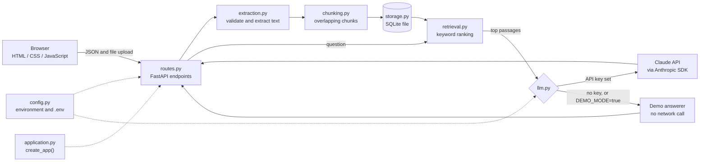

# DocuMind: Document Q&A Assistant

DocuMind lets you upload a **PDF or TXT** file and ask questions about it. It finds the passages
most relevant to your question and shows them as sources, with page numbers for PDFs.
If you add an Anthropic API key, Claude writes the answer using only those passages.
Without a key, DocuMind runs in **demo mode**, which needs no key and makes no AI calls.

Built with Python 3.11+, FastAPI, Pydantic, pypdf, SQLite, the Anthropic Python SDK,
plain HTML/CSS/JavaScript, and pytest. It is a learning and portfolio project for a single local user.

> New to running Python projects on Windows? Read [SETUP_GUIDE.md](SETUP_GUIDE.md).
> For a checklist of what has and has not been verified, read [PROJECT_CHECKLIST.md](PROJECT_CHECKLIST.md).

---

## Features

- Upload `.pdf` and `.txt` files from a web page, and see the stored documents and their sizes.
- Validation before any processing: file type, file signature, size limit, empty files, binary data,
  non-UTF-8 text, PDFs with no extractable text, damaged PDFs, and password-protected PDFs.
- Safe file names: folder parts such as `..\..\` are removed, and the file name is only ever stored as text.
- Duplicate detection: uploading the exact same file again returns a 409 error instead of storing it twice.
- Text extraction with page numbers for PDFs.
- Overlapping chunks (configurable size and overlap). A chunk never spans two PDF pages.
- **Keyword retrieval**: chunks are ranked by shared words, with rare words weighted higher.
  This is not semantic search and does not use embeddings or a vector database.
- Answers in Claude mode are generated from the retrieved excerpts only. The system prompt treats the document text as untrusted.
- Source excerpts, page references, and a clear label for demo answers.
- Health check, upload, list, delete one, delete all, and ask endpoints.
- Automated tests that use fake Claude clients, so no paid API calls are needed.

## Architecture and request flow



Example request flow for a question: the browser sends `POST /api/ask` → FastAPI checks the JSON →
the store loads the chunks → the retriever picks the best `TOP_K` chunks → the answerer (Claude or demo)
produces the answer → the route returns the answer and its sources as JSON.

## Folder structure

```text
documind/
├── app/
│   ├── application.py   # startup: builds the app, database, retriever, and answerer
│   ├── main.py          # entry point for uvicorn (app.main:app)
│   ├── config.py        # settings from environment variables and .env
│   ├── errors.py        # error types that carry an HTTP status code
│   ├── schemas.py       # Pydantic request and response models
│   ├── routes.py        # HTTP endpoints
│   ├── extraction.py    # file-name cleaning, validation, PDF and TXT text extraction
│   ├── chunking.py      # overlapping chunks that keep page numbers
│   ├── retrieval.py     # keyword ranking
│   ├── llm.py           # Claude answerer, demo answerer, system prompt, error mapping
│   └── storage.py       # SQLite tables, duplicate lookup, delete and clear
├── static/
│   ├── index.html       # the web page
│   ├── app.js           # browser logic; calls /api only, never sees the key
│   └── styles.css       # responsive styling
├── sample_data/
│   └── synthetic_company_handbook.txt   # fictional document for trying the app
├── tests/               # pytest tests (fake Claude clients, temporary databases)
├── .env.example         # placeholders only; copy to .env
├── .gitignore
├── pytest.ini
├── requirements.txt
├── LICENSE              # MIT
├── README.md
├── SETUP_GUIDE.md       # step-by-step Windows and VS Code guide, with troubleshooting
└── PROJECT_CHECKLIST.md # what has been verified, and how
```

## Quick start (Windows PowerShell)

From the project folder:

```powershell
python -m venv .venv
.\.venv\Scripts\Activate.ps1
python -m pip install -r requirements.txt
Copy-Item .env.example .env
python -m uvicorn app.main:app --reload --host 127.0.0.1 --port 8000
```

Open <http://127.0.0.1:8000>. Without a real API key, the badge says **Demo mode (no AI calls)**.
If `Activate.ps1` is blocked, see the troubleshooting section of `SETUP_GUIDE.md`.

## Configuration

Settings come from environment variables. A local `.env` file is loaded automatically if it exists.
A missing `.env` is fine: every setting has a default.

| Variable | Default | Required? | Purpose |
|---|---|---|---|
| `ANTHROPIC_API_KEY` | *(empty)* | Only for Claude mode | Your API key. Empty or the placeholder value means demo mode. |
| `ANTHROPIC_MODEL` | `claude-haiku-5-5` | No | Model ID sent to the API. |
| `ANTHROPIC_TIMEOUT_SECONDS` | `30` | No | Seconds to wait for Claude before a 504 error. |
| `DEMO_MODE` | `false` | No | `true` forces demo mode even when a key is set. |
| `MAX_UPLOAD_MB` | `5` | No | Largest accepted upload. The browser reads this value from the server. |
| `CHUNK_SIZE` | `800` | No | Maximum characters per chunk. |
| `CHUNK_OVERLAP` | `150` | No | Characters shared by neighbouring chunks. Must be smaller than `CHUNK_SIZE`. |
| `TOP_K` | `4` | No | Number of passages used for each answer. |
| `DATABASE_PATH` | `data/documind.db` | No | SQLite file. Relative paths start from the project folder. |
| `LOG_LEVEL` | `INFO` | No | Logging level. |

**Model ID:** `claude-haiku-5-5` was checked against Anthropic's model documentation
(platform.claude.com, Claude Haiku 5.5 page), which lists it as the API identifier.
If a future model is retired, change `ANTHROPIC_MODEL` in `.env`. An unknown model returns a clear error, not a guessed answer.

## Demo mode and Claude mode

| | Demo mode | Claude mode |
|---|---|---|
| When it runs | No API key, or `DEMO_MODE=true` | `ANTHROPIC_API_KEY` is set and `DEMO_MODE` is not `true` |
| Network calls to Anthropic | None | One per question |
| Answer source | Top passage, quoted with a `DEMO MODE` label | Claude, using only the excerpts |
| Health `mode` value | `demo` | `claude` |

Claude mode never falls back to demo answers silently. If the API fails, the app returns an error message.
Demo answers are not real answers: they show the best passage and do not summarize it.

## API endpoints

Interactive documentation: <http://127.0.0.1:8000/docs> (available while the server runs).

| Method | Path | Purpose | Success | Error codes |
|---|---|---|---|---|
| GET | `/api/health` | Status, mode, version, upload limit, and model name (Claude mode only) | 200 | — |
| POST | `/api/documents` | Upload one `.pdf` or `.txt` file (form field `file`) | 201 | 400 empty, 409 duplicate, 413 too large, 415 wrong type or content, 422 no readable text |
| GET | `/api/documents` | List stored documents (metadata only, never the file) | 200 | — |
| DELETE | `/api/documents/{document_id}` | Delete one document and all its chunks | 204 | 404 not found |
| DELETE | `/api/documents` | Delete every document and chunk | 200 | — |
| POST | `/api/ask` | Ask a question. JSON body: `question` (3–1000 characters), optional `document_ids` | 200 | 404 no documents or unknown id, 422 invalid input, 429/502/503/504 AI problems |

Every error response has the form `{"detail": "a readable message"}`.

### Example requests (PowerShell)

```powershell
# Health check
curl.exe http://127.0.0.1:8000/api/health

# Upload the sample document
curl.exe -X POST -F "file=@sample_data/synthetic_company_handbook.txt" http://127.0.0.1:8000/api/documents

# Ask a question (JSON body built with Invoke-RestMethod)
$body = @{ question = "How many vacation days do employees get?" } | ConvertTo-Json
Invoke-RestMethod -Method Post -Uri http://127.0.0.1:8000/api/ask -ContentType "application/json" -Body $body

# Delete everything
curl.exe -X DELETE http://127.0.0.1:8000/api/documents
```

## Retrieval approach and its limits

- Words are lowercased, split apart, and stopwords such as "the" and "is" are removed.
- Each chunk is scored by the query words it contains. Rare words count more, and a chunk's length is taken into account.
- Ties are broken by document and chunk order, so results repeat exactly.
- **Limits:** it matches words, not meanings. "Holiday" will not find "vacation" unless the text uses that word.
  Synonyms, paraphrases, and questions in another language are not handled. Adding embeddings would require a new
  retriever class with the same `rank` method; that is future work and is not implemented.

## Security and privacy

- The API key is read only on the server. It is never sent to the browser, never returned by any endpoint, and never written to the log.
  Tests check that the key does not appear in API responses or in the messages sent to Claude.
- Document text is untrusted. It is wrapped in tags, and the system prompt tells the model to ignore instructions inside it.
  The sample file contains a deliberate "ignore your instructions" line to test this. The model's behaviour is not guaranteed; the rule is a
  prompt-level defence, not a security boundary.
- Uploaded file names are reduced to a safe display name and are never used as file paths. Tests cover `../` and `..\` names.
- The browser inserts all document text with `textContent`, never as HTML.
- Raw error text from the AI service is not shown to users. Known error types map to a short message naming the setting to check.

**Limitations of the security measures:**

- Designed for one person on their own computer. There is no login, no user accounts, and no per-user data separation.
- No rate limiting, no HTTPS, and no protection against a determined attacker on the same network.
  Do not expose this server to the public internet.
- Stored data is not encrypted. Anyone with access to the `data/` folder can read the extracted text.

## Data retention

| What | Where | How long |
|---|---|---|
| Uploaded file bytes | Memory only, during the upload request | Discarded after text extraction |
| File name, type, size, page count, upload time, SHA-256 fingerprint | `data/documind.db`, table `documents` | Until you delete the document |
| Extracted text chunks, with page numbers | `data/documind.db`, table `chunks` | Until you delete the document |

Deleting a document removes its rows, and then SQLite `VACUUM` rewrites the database file so the removed text is not left in free space.
Deleting the `data/` folder also removes everything.

## Testing

```powershell
python -m pytest
```

The tests cover: configuration with and without a key, invalid settings, file validation, file-name cleaning, PDF and TXT extraction,
chunking, keyword ranking, insufficient evidence, Claude API errors (mocked), prompt-injection handling,
every endpoint, database restart persistence, the duplicate and delete behaviour, and a check that the
browser code calls routes that exist.

Tests use temporary databases and never call the Anthropic API. The number of tests changes as the suite grows;
run `python -m pytest` yourself to see the current result.

## Known limitations and possible future work

- Keyword retrieval only; no embeddings or semantic search.
- No OCR: scanned PDFs without a text layer are rejected.
- PDF layout is simplified: tables and multi-column pages may be extracted in an odd order.
- Password-protected PDFs are not supported.
- Chunks are built from text with whitespace collapsed, so paragraph breaks are lost.
- Every question loads all chunks of the selected documents into memory. Fine for a few documents; a larger collection needs an index.
- Demo answers quote the top passage. For some questions that passage is the document header.
- Single-user, local use only.
- Browser behaviour was checked by reading and testing the code, not by clicking through the page in a real browser (see the checklist).
- Possible next steps: embeddings with a vector index, PDF table extraction, authentication, and deployment with HTTPS.

## Troubleshooting

The full troubleshooting section is in [SETUP_GUIDE.md](SETUP_GUIDE.md#common-errors-and-verified-fixes).

## GitHub publication

These commands are for you to run. Nothing is committed or pushed automatically.

```powershell
git init
git status                        # check that .env, .venv/ and data/ are NOT listed
git add .
git status                        # check again before committing
git commit -m "Initial commit: DocuMind document Q&A assistant"
git branch -M main
git remote add origin https://github.com/<your-github-username>/documind.git
git push -u origin main
```

Replace `<your-github-username>` with your GitHub username. Before pushing, confirm that no file contains a real API key.
The full steps are in `SETUP_GUIDE.md`.

## License

MIT. See [LICENSE](LICENSE). Replace `[Your Name]` in the license before publishing.
